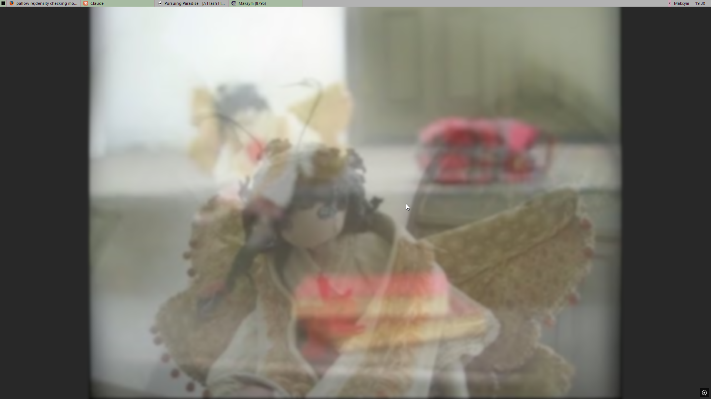

# Cairo Minimal Taskbar

A fork of [Cairo Desktop](https://github.com/cairoshell/cairoshell) that adds a very small, flat, xfce4 / fvwm3 style taskbar.



## Features
- Thin bar (18 px by default), light grey with black text, flat plain buttons, no divider lines
- Task buttons with icon and title; the active window is highlighted
- Drag task buttons to reorder them; Win+1..0 switches to them like the Windows taskbar
- Square start button that opens the Windows Start menu
- Tray icons you can show, hide into an overflow or remove, and collapse all at once
- Clock and a small show desktop strip
- User button with the account name: Lock, Sign out, Sleep, Hibernate, Restart, Shut down
- Hiding: fade to a set opacity (with show / hide delays), slide away, or reserve screen space
- Every color settable by hand, a palette generated from one accent color, and alternate colors for every second task button
- Save and load themes (`%LOCALAPPDATA%\Cairo Desktop\MinTaskbarThemes\*.theme`)
- Light, native Windows right-click menus; task buttons offer Open file location and Close
- Option to turn off Cairo's menu bar
- Renders on the CPU so the bar doesn't go blank after full screen games, sleep or display changes

Right-click the bar and choose **Taskbar settings...** to change any of it.

## Build
Needs the .NET 10 SDK.

```
dotnet build "Cairo Desktop/Cairo Desktop/Cairo Desktop.csproj" -f net10.0-windows -c Release -p:Platform=x64
```

The app ends up in `Cairo Desktop/Cairo Desktop/bin/x64/Release/net10.0-windows/win-x64/CairoDesktop.exe`. It runs alongside Explorer; it doesn't need to replace the shell.

## Where the code is
- `Cairo Desktop/CairoDesktop.Taskbar/MinimalTaskbar*.cs/.xaml` - the bar, task list, drag and Win+N
- `Cairo Desktop/CairoDesktop.Taskbar/MinimalTaskbarSettings.*` - settings window
- `Cairo Desktop/CairoDesktop.Taskbar/MinimalPalette.cs`, `MinimalThemes.cs`, `NativeMenu.cs`, `WinNumberHook.cs`
- `Cairo Desktop/CairoDesktop.Common/Settings.cs` - the `MinTaskbar*` settings

## License
Apache License 2.0, same as Cairo (see [LICENSE](LICENSE)). This fork modifies `Settings.cs` and `TaskbarWindowService.cs` and adds the files listed above. All credit for Cairo itself goes to the [Cairo team](https://github.com/cairoshell/cairoshell).
